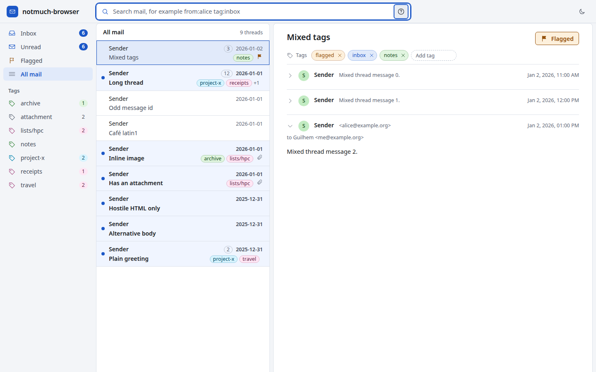

# notmuch-browser

A small web UI to search, read and tag the mail in a [notmuch](https://notmuchmail.org) database. It runs on your own machine and talks to the `notmuch` command line. Your mail never leaves the computer it is on.



## Install

You need Python 3.11 or newer and the `notmuch` command (0.36 or newer, developed against 0.40). You do not need Node.

```sh
uv tool install notmuch-browser
notmuch-browser
```

Or run it once without installing:

```sh
uvx notmuch-browser
```

The server listens on `http://127.0.0.1:8765/` and opens your browser. Options:

| Option | Meaning |
|---|---|
| `--port N` | listen on another port (default 8765) |
| `--notmuch-config FILE` | use a specific notmuch configuration file |
| `--no-browser` | do not open a browser window |

## Using it

Type a notmuch query in the search field and press Enter. The help button next to the field lists the common prefixes, and `man notmuch-search-terms` has the full syntax. The left rail holds saved searches (Inbox, Unread, Flagged, All mail) and every tag, with the number of unread threads loading in the background.

| Key | Action |
|---|---|
| `/` | focus the search field |
| `j` / `k` | next and previous thread |
| `f` | flag or unflag the open thread |
| `t` | add a tag to the open thread |

Tag changes show an Undo button. Undo restores exactly the messages that the change touched, so a thread that was only partly flagged returns to its earlier state.

HTML mail is cleaned and shown in a sandboxed frame. Scripts, forms, styles and remote images are removed, so tracking pixels do not load. Inline images that belong to the message are shown. Attachments download as files.

The light and dark themes follow your system. The button in the top bar overrides it and the choice is remembered in the browser.

## What it does to your mail

Reading changes nothing. The only write is `notmuch tag`. It never indexes, sends, composes or deletes.

Read this if you use `maildir.synchronize_flags=true` (the notmuch default): changing the `unread`, `flagged`, `replied`, `draft` or `passed` tags renames the message files in your Maildir, because notmuch keeps the Maildir flags in step. If an IMAP sync tool also works on that Maildir, avoid tagging while it runs. If another program holds the database write lock, for example `notmuch new`, a tag change fails after a few seconds with a clear "database busy" message and changes nothing.

## Security model

- The server binds `127.0.0.1` only. There is no option to change that and there is no login.
- Requests with an unexpected `Host` header are refused, which stops DNS rebinding. Writes also need a matching `Origin` and a JSON content type, and cross-site requests are refused.
- The one cross-site request that is served is the image load of a message's inline `cid:` image from the sandboxed mail frame, because a browser labels that frame's requests cross-site. A foreign web page could use it only to learn that an image part exists and how large it is, and only if it already knew the message id.
- Attachments are always sent as downloads with a restrictive content security policy.
- On a shared machine other local users can reach the port. Do not run it there.

## Development

```sh
uv sync
npm ci
npm run build          # compiles web/src into src/notmuch_browser/static
uv run pytest          # tests use a throwaway database, never your real one
uv run notmuch-browser --notmuch-config "$(uv run python scripts/fixture_db.py /tmp/nb-fixture)"
```

`npm run dev` rebuilds on change. The Python server serves the built files, so reload the page.

`node scripts/shots.mjs <notmuch-config>` drives the real UI with Playwright against a fixture database, checks behaviour and writes screenshots.

### Releasing

```sh
scripts/release.sh
```

builds the bundle, then the wheel and sdist, and checks their contents. The bundle is not stored in git, so a wheel built without `npm run build` would have no UI. The build refuses to run in that case. The script does not upload anything. Publish with `uv publish` when you are ready.

## License

MIT
